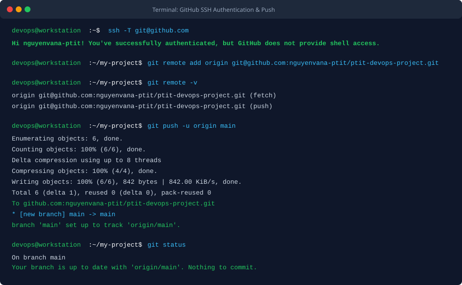
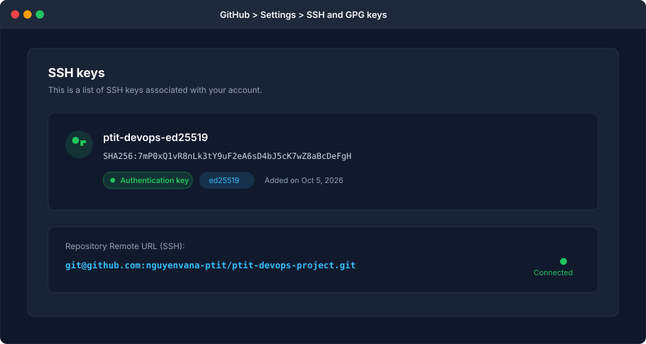

BÀI TẬP 3: CẤU HÌNH XÁC THỰC SSH VÀ ĐẨY DỰ ÁN LÊN GITHUB

I. MỤC TIÊU BÀI TẬP

1. Khởi tạo cặp khóa xác thực SSH bằng thuật toán Ed25519 hiện đại, có độ bảo mật cao và hiệu năng xử lý tối ưu so với chuẩn RSA truyền thống.
2. Thiết lập tích hợp khóa công khai (Public Key) vào tài khoản GitHub phục vụ cơ chế xác thực bất đối xứng an toàn, loại bỏ hoàn toàn việc phải nhập mật khẩu hoặc Personal Access Token thủ công.
3. Kiểm tra tính thông suốt và tính danh tính của kết nối SSH tới hạ tầng GitHub thông qua lệnh ssh -T git@github.com.
4. Cấu hình liên kết kho lưu trữ từ xa (Remote Origin) bằng định dạng URL SSH cho repository cục bộ.
5. Thực hiện đẩy (push) toàn bộ nhánh chính main cùng lịch sử commit lên GitHub thành công.


II. BỐI CẢNH VÀ THÔNG SỐ CẤU HÌNH

1. Tên máy trạm thao tác: devops@workstation
2. Tài khoản GitHub cá nhân: nguyenvana-ptit
3. Tên kho lưu trữ trên GitHub: ptit-devops-project
4. Đường dẫn kho lưu trữ từ xa dạng SSH: git@github.com:nguyenvana-ptit/ptit-devops-project.git
5. Đường dẫn truy cập web GitHub: https://github.com/nguyenvana-ptit/ptit-devops-project
6. Thuật toán sinh khóa: Ed25519 (chuẩn Edwards-curve)
7. Tệp tin khóa riêng tư (Private Key): ~/.ssh/id_ed25519_github (bảo mật tuyệt đối, không chia sẻ)
8. Tệp tin khóa công khai (Public Key): ~/.ssh/id_ed25519_github.pub (dùng để gán lên GitHub)


III. CÁC BƯỚC THỰC HIỆN CHI TIẾT

1. Bước 1: Khởi tạo cặp khóa SSH Ed25519

Tại máy trạm cục bộ, chạy lệnh sinh cặp khóa với thuật toán ed25519:

```bash
ssh-keygen -t ed25519 -C "nguyenvana@ptit.edu.vn" -f ~/.ssh/id_ed25519_github -N ""
```

Lệnh trên tạo ra hai tệp tin trong thư mục ~/.ssh/:
- id_ed25519_github: Tệp khóa riêng tư dùng để ký điện tử trong mỗi phiên giao dịch SSH.
- id_ed25519_github.pub: Tệp khóa công khai dùng để giải mã và xác minh chữ ký.

Thiết lập phân quyền bảo mật chuẩn cho thư mục SSH:

```bash
chmod 700 ~/.ssh
chmod 600 ~/.ssh/id_ed25519_github
chmod 644 ~/.ssh/id_ed25519_github.pub
```

2. Bước 2: Trích xuất nội dung khóa công khai

Xem và sao chép toàn bộ chuỗi ký tự của khóa công khai:

```bash
cat ~/.ssh/id_ed25519_github.pub
```

Nội dung hiển thị có dạng tương tự:

```text
ssh-ed25519 AAAAC3NzaC1lZDI1NTE5AAAAIOmNp7xK8yJ2rF4qN1tU9vE6zS3wD0bA5cK7mZ8aBcDe nguyenvana@ptit.edu.vn
```

3. Bước 3: Thêm khóa SSH công khai vào tài khoản GitHub

Thực hiện các bước trên giao diện web GitHub:
- Đăng nhập vào tài khoản cá nhân trên GitHub.
- Bấm vào ảnh đại diện ở góc trên bên phải, chọn mục Settings.
- Tại thanh điều hướng bên trái, chọn thẻ SSH and GPG keys.
- Bấm nút New SSH key.
- Ô Title: Đặt tên gợi nhớ cho máy tính đang dùng (ví dụ: ptit-devops-ed25519).
- Ô Key type: Chọn Authentication Key.
- Ô Key: Dán toàn bộ chuỗi ký tự khóa công khai đã sao chép từ Bước 2.
- Bấm Add SSH key để xác nhận.

4. Bước 4: Kiểm tra xác thực SSH tới máy chủ GitHub

Thực hiện lệnh kiểm tra đường truyền và danh tính:

```bash
ssh -T git@github.com
```

Kết quả phản hồi xác nhận thành công từ GitHub:

```text
Hi nguyenvana-ptit! You've successfully authenticated, but GitHub does not provide shell access.
```

5. Bước 5: Cấu hình liên kết Remote URL cho Local Repository

Di chuyển vào thư mục dự án cục bộ và gán địa chỉ remote dạng SSH:

```bash
cd ~/my-project
git remote add origin git@github.com:nguyenvana-ptit/ptit-devops-project.git
```

Kiểm tra danh sách remote đã được thiết lập:

```bash
git remote -v
```

Đầu ra xác nhận cả hai chiều fetch và push đều trỏ về địa chỉ SSH:

```text
origin  git@github.com:nguyenvana-ptit/ptit-devops-project.git (fetch)
origin  git@github.com:nguyenvana-ptit/ptit-devops-project.git (push)
```

6. Bước 6: Đẩy mã nguồn lên GitHub

Thực hiện lệnh push nhánh main lên kho lưu trữ từ xa:

```bash
git branch -M main
git push -u origin main
```

Cờ -u (set-upstream) giúp liên kết nhánh main cục bộ với nhánh main trên remote origin, từ các lần sau chỉ cần gõ git push hoặc git pull.


IV. KIỂM TRA VÀ XÁC MINH CẤU HÌNH

1. Lệnh 1: Xác nhận kết nối SSH

```bash
ssh -T git@github.com
```

Đầu ra ghi nhận:

```text
Hi nguyenvana-ptit! You've successfully authenticated, but GitHub does not provide shell access.
```

2. Lệnh 2: Xác nhận Remote URL

```bash
git remote -v
```

Đầu ra ghi nhận:

```text
origin  git@github.com:nguyenvana-ptit/ptit-devops-project.git (fetch)
origin  git@github.com:nguyenvana-ptit/ptit-devops-project.git (push)
```

3. Lệnh 3: Xác nhận trạng thái đồng bộ sau khi push

```bash
git status
```

Đầu ra ghi nhận:

```text
On branch main
Your branch is up to date with 'origin/main'.
nothing to commit, working tree clean
```


V. HÌNH ẢNH MINH HỌA VÀ NHẬT KÝ THAO TÁC

1. Terminal kiểm tra xác thực SSH, thêm remote và git push thành công



2. Giao diện cấu hình SSH Key trên GitHub Settings



3. Nhật ký phiên làm việc kiểm tra từ Terminal

```text
devops@workstation:~$ ssh -T git@github.com
Hi nguyenvana-ptit! You've successfully authenticated, but GitHub does not provide shell access.
devops@workstation:~/my-project$ git remote add origin git@github.com:nguyenvana-ptit/ptit-devops-project.git
devops@workstation:~/my-project$ git remote -v
origin  git@github.com:nguyenvana-ptit/ptit-devops-project.git (fetch)
origin  git@github.com:nguyenvana-ptit/ptit-devops-project.git (push)
devops@workstation:~/my-project$ git push -u origin main
Enumerating objects: 6, done.
Counting objects: 100% (6/6), done.
Delta compression using up to 8 threads
Compressing objects: 100% (4/4), done.
Writing objects: 100% (6/6), 842 bytes | 842.00 KiB/s, done.
Total 6 (delta 1), reused 0 (delta 0), pack-reused 0
To github.com:nguyenvana-ptit/ptit-devops-project.git
 + [new branch]      main -> main
branch 'main' set up to track 'origin/main'.
```


VI. THÔNG TIN KHO LƯU TRỮ VÀ HƯỚNG DẪN NỘP BÀI

1. Đường dẫn trên GitHub: homework/session_04/ex3/ (hoặc Session04/BT3/)
2. URL kho lưu trữ SSH: git@github.com:nguyenvana-ptit/ptit-devops-project.git
3. URL giao diện web: https://github.com/nguyenvana-ptit/ptit-devops-project
4. Cơ chế nộp bài: Học viên nộp tệp báo cáo README.md mô tả chi tiết toàn bộ các bước thiết lập khóa Ed25519, liên kết remote origin và kết quả đẩy mã nguồn lên GitHub. Tuyệt đối không nộp tệp khóa riêng tư private key lên kho lưu trữ.


VII. KẾT LUẬN VÀ BÀI HỌC KINH NGHIỆM

1. Sử dụng giao thức SSH kết hợp thuật toán Ed25519 là chuẩn mực bảo mật hàng đầu trong ngành DevOps hiện đại, mang lại tốc độ xử lý nhanh, chiều dài khóa ngắn gọn và khả năng chống lại các phương thức tấn công giả mạo hiệu quả hơn hẳn thuật toán RSA cũ.
2. Cơ chế khóa bất đối xứng giúp quy trình làm việc tự động hóa (CI/CD) diễn ra liền mạch, an toàn mà không cần lưu trữ thông tin đăng nhập nhạy cảm trong mã nguồn dự án.
3. Luôn tuân thủ nguyên tắc quản lý khóa: Khóa công khai (.pub) có thể chia sẻ rộng rãi, trong khi khóa riêng tư phải luôn được bảo vệ an toàn trên thiết bị cá nhân với phân quyền chặt chẽ (chmod 600).
